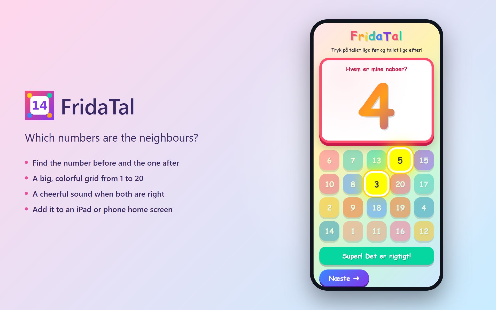

# FridaTal


[](LICENSE)
[](https://github.com/kreaton/FridaTal/stargazers)

⭐ If FridaTal earns a place on your machine, [star it on GitHub](https://github.com/kreaton/FridaTal) — it's free, made by one developer, and stars are how other people find it.



**A small number game for kids.**

▶️ **Play it:** <https://kreaton.github.io/KidsGames/fridatal/>

A number between 2 and 19 is shown, and the child
clicks the number just **before** and the number just **after** it on a grid of
1–20. A cheerful sound plays when both are right, and an "uh-oh" sound when the
two picks are wrong. **Næste ➜** (Next) starts a new round.

Built with Blazor WebAssembly on .NET 10, so it runs entirely in the browser and
can be installed to an iPad/phone home screen as a PWA.

## Requirements

- .NET 10 SDK (`dotnet --list-sdks` should list a `10.0.x` version)
- A trusted HTTPS dev certificate for the https URL:

  ```bash
  dotnet dev-certs https --trust
  ```

## Running locally

Requires the [.NET 10 SDK](https://dotnet.microsoft.com/download).

```bash
dotnet run --project src/FridaTal
```

Then open <http://localhost:5161> (or <https://localhost:7161>). In Visual Studio, open `FridaTal.slnx` and press F5; the `FridaTal` launch profile opens the browser automatically.

## Publishing

Pushing to `main` builds the app and puts it in the `fridatal/` folder of the KidsGames GitHub Pages site (<https://kreaton.github.io/KidsGames/fridatal/>) with [`.github/workflows/deploy.yml`](.github/workflows/deploy.yml). It needs the repository secret `PAGES_DEPLOY_KEY`: the private half of a deploy key with write access to `kreaton/KidsGames`.

The app is served from a `fridatal` sub-path: `<base href>` in [`wwwroot/index.html`](src/FridaTal/wwwroot/index.html) is `fridatal`.

## Project layout

| Path | What it is |
| --- | --- |
| `src/FridaTal/Pages/Home.razor` | The whole game: picking the number, the grid and checking answers |
| `src/FridaTal/wwwroot/css/app.css` | All styling, including the landscape (iPad) layout |
| `src/FridaTal/wwwroot/js/sounds.js` | Success and error sounds, synthesized with the Web Audio API (no audio files) |
| `src/FridaTal/wwwroot/index.html` | Host page, icons and PWA meta tags |
| `src/FridaTal/wwwroot/manifest.webmanifest` | PWA manifest for "Add to Home Screen" |

## Changing the game

- **Number range:** `Min` and `Max` in `Home.razor`. The grid has 5 columns, and
  the landscape layout assumes 4 rows (`grid-template-rows` in `app.css`).
- **Sounds:** edit the notes in `sounds.js`. Browsers only allow sound after the
  first tap, which the game always has before a sound plays.

## License & Authorship

This project is distributed under the terms of the [MIT License](LICENSE).

**AI authorship note:** Most of the source code in this repository was generated with AI coding agents (Claude Code), under my direction and review. Purely AI-generated material may not be eligible for copyright protection in some jurisdictions. To the extent any part of this project is protected by copyright, it is licensed under the MIT License, and the license's warranty and liability disclaimers apply to the project as a whole.

<!-- notices:start -->
### Independent development

FridaTal is an independent, personal project developed by Per Hejndorf. It is not affiliated with, endorsed by or sponsored by Microsoft or any other rights holder. Product names and logos are trademarks of their respective owners and are used only to identify the services and tools the project works with.

### Third-party notices and asset provenance

[THIRD-PARTY-NOTICES.md](THIRD-PARTY-NOTICES.md) lists every third-party library, font and online service the project uses, with version, licence, source and whether it was modified. It also records where the icons, images, audio and video came from and how they are licensed.
<!-- notices:end -->
